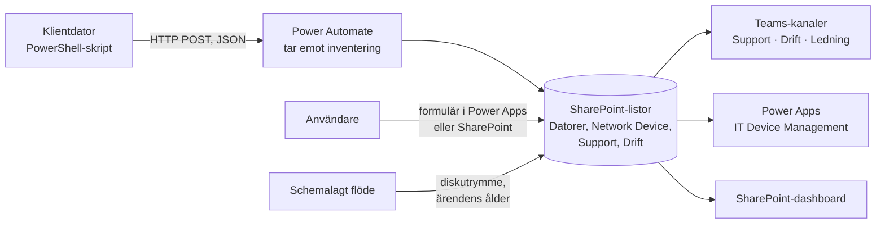

# IT Device Management och support – XENODE

Ett supportsystem för IT-avdelningen hos det fiktiva företaget XENODE, byggt helt i Microsoft 365: ärenden, eskalering, SLA-varningar och hårdvaruövervakning, utan externa verktyg. Byggt i supportkursens IT-digitaliseringsprojekt, våren 2026.

**Typ:** individuellt. Beskrivningen bygger på min dokumentation i examinationen (betyg VG) och mina två skript. Det finns inga skärmbilder av systemet.

## Översikt

## Delar

| Del | Lösning |
| --- | --- |
| Samarbete | Teams-gruppen IT med kanalerna **Support** (inkommande ärenden och kunskapsbas), **Drift** (eskalerade ärenden och serverövervakning) och **Ledning** (privat kanal för konfidentiell information) |
| Data | SharePoint-listor för ärenden, datorer och nätverksenheter |
| Hårdvaruinventering | Ett PowerShell-skript på klienten skickar enhetsnamn, tillverkare, modell, IP-adress, RAM, disk och serienummer till ett flöde som sparar datorn |
| Diskvarning | Ett schemalagt flöde kontrollerar ledigt diskutrymme. Under 20 % skapas ett supportärende och raden färgas gul; under 10 % blir den röd. |
| Nätverksenheter | IP-fältet visas bara när enheten är markerad som nätverksenhet |
| Ärenden | Användare skapar ärenden via ett formulär i Power Apps eller SharePoint. Ansvariga får en notis i Teams och teknikerna ett mejl. |
| SLA | Ett supportärende som är äldre än 10 dagar ger en varning om att det måste stängas eller eskaleras. I Drift sker det efter 3 dagar. |
| Eskalering | Kolumnen **Eskalera till Drift** flyttar ärendet till Drifts lista och stänger det ursprungliga |
| App | Power Apps-appen **IT Device Management**: ärenden, övervakade enheter, nätverksenheter och kontakter. Appen visar flera diskar per dator och hindrar att samma enhet registreras två gånger. |
| Dashboard | Räknare för aktiva ärenden i Support och Drift, och en vy som visar nästa högprioriterade ärende och dagar kvar till deadline |
| Kunskapsbas | En [supportsida i Notion](https://closed-newsboy-41a.notion.site/XENODE-IT-Helpdesk-3478b48bc35d808186b0d598fb27020a), byggd i en övning för att KB-artiklar och ärendeformuläret skulle gå att nå även utan Microsoft 365-konto |

## Skript

| Skript | Vad det gör |
| --- | --- |
| [`Send-DeviceInventory.ps1`](scripts/Send-DeviceInventory.ps1) | Läser hårdvaruinformation med CIM och skickar den som JSON till inventeringsflödet |
| [`Register-NetworkDevice.ps1`](scripts/Register-NetworkDevice.ps1) | Registrerar en nätverksenhet, till exempel en skrivare, via ett annat flöde |

Båda skripten skickar data till en flödestrigger av typen *When an HTTP request is received*. Flödets URL innehåller en signatur (`sig=`) som fungerar som ett lösenord. I originalskripten stod URL:en direkt i koden. Nu anges den som parameter eller miljövariabel. Se [CHANGES.md](../CHANGES.md).

## Supportmetodik

Arbetssättet bakom systemet, från samma examination:

1. **Lyssna** – låt användaren prata klart.
2. **Bekräfta** – upprepa problemet för att visa att jag förstått.
3. **Kategorisera** – hårdvara, mjukvara eller nätverk.
4. **Prioritera** – hur kritiskt är felet?
5. **Isolera** – testa en sak i taget och stryk det som inte är orsaken.
6. **Dokumentera** – skriv ner vad jag gör, så att lösningen finns nästa gång.

Det följer CompTIAs felsökningsmetodik: identifiera problemet, formulera en teori om orsaken, testa teorin, gör en åtgärdsplan och genomför den, verifiera att allt fungerar och dokumentera.

## Säkerhet

- **Minsta möjliga behörighet:** ledningens information ligger i en privat kanal.
- **Hemligheter i kod:** flödes-URL:er är lösenord och hör inte hemma i skript eller repon. Det är den viktigaste lärdomen från de här skripten.
- **Övervakning som säkerhet:** en enhet som slutar rapportera eller vars disk plötsligt fylls kan vara ett tecken på skadlig kod och ska eskaleras till Drift.
- **Premiumlicens:** HTTP-triggern i Power Automate kräver en premiumlicens.
