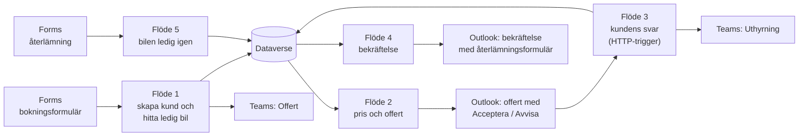
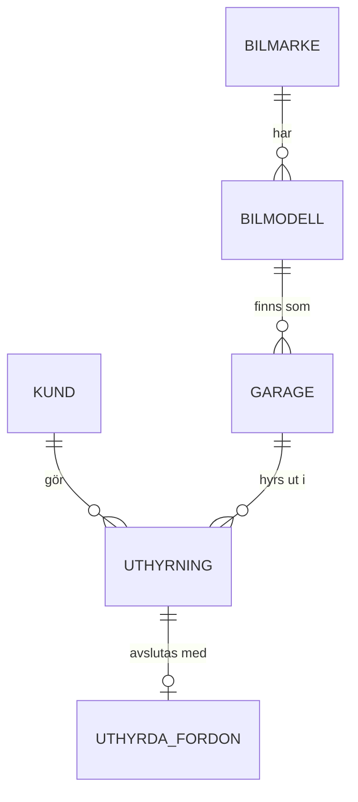

# Valentino Rental – biluthyrning i Power Platform

Ett system för det fiktiva biluthyrningsföretaget Valentino Rental AB. Det hanterar hela flödet: kundens förfrågan online, automatisk prissättning och offert, kundens svar, bokningsbekräftelse och återlämning av bilen. Byggt i Microsoft 365-kursen.

**Typ:** gemensamt grupparbete där jag deltog. Beskrivningen bygger på systemdokumentationen; det finns inga skärmbilder.

## Arkitektur

## Datamodell i Dataverse

| Tabell | Innehåll |
| --- | --- |
| Bilmärke | Till exempel Volvo, BYD |
| Bilmodell | Modell kopplad till märke, till exempel XC60, SEAL |
| Garage | Bilflottan: registreringsnummer, modell, mätarställning, inköpsdatum, ålder, tillgänglig ja/nej, kategori, bränsle, årsmodell |
| Kund | Förnamn, efternamn, e-post, telefon, personnummer och körkortsnummer |
| Uthyrning | Kärntabellen: kund, bil, start- och slutdatum, antal dagar, totalpris, status och tidpunkt för godkänd offert |
| Kategori | Mini, Sedan, Skåp, SUV |
| Uthyrda fordon | Data från återlämningsformuläret, kopplad till rätt uthyrning |

Beräknade kolumner:

| Tabell | Kolumn | Formel |
| --- | --- | --- |
| Garage | Ålder i dagar | `DIFFINDAYS(inköpsdatum, NOW())` |
| Kund | Namn | `CONCATENATE(förnamn, " ", efternamn)` |
| Uthyrning | Antal dagar | `DIFFINDAYS(startdatum, slutdatum)` |

## Flödena

| Flöde | Trigger | Vad det gör |
| --- | --- | --- |
| 1. Bokningsformulär | Kunden skickar formuläret i Microsoft Forms | Läser önskat drivmedel och växellåda, skapar kunden, söker en ledig bil som matchar och skapar en uthyrning som väntar på kunden. Skickar ett Adaptive Card till Teams-kanalen Offert. |
| 2. Pris och offert | En ny post med status väntande | Hämtar bil och kund, räknar totalpris som hyrdagar × dagspris, sparar priset och mejlar en offert med länkarna Acceptera och Avvisa |
| 3. Kundens svar | HTTP-begäran när kunden klickar på en länk | Vid accept: status Bekräftad och bilen markeras som otillgänglig, personalen får en notis i Teams. Vid avvisning: status Avvisad och priset nollställs. |
| 4. Bekräftelse | Status ändras till Bekräftad | Mejlar en bekräftelse med uthyrnings-ID, registreringsnummer och länk till återlämningsformuläret |
| 5. Återlämning | Kunden fyller i återlämningsformuläret | Markerar bilen som tillgänglig och sätter uthyrningens status till Återlämnad |

## Säkerhet och dataskydd

- **Personnummer och körkortsnummer** är känsliga personuppgifter. Om systemet användes på riktigt skulle de behöva skyddas med begränsad åtkomst, till exempel säkerhetsroller och kolumnsäkerhet i Dataverse, och sparas bara så länge det behövs enligt GDPR. *Skrivet vid portföljarbetet.*
- **Länkarna i offertmejlet** är HTTP-triggers. Den som har länken kan svara på offerten, så de ska vara unika per uthyrning och inte gå att gissa. *Skrivet vid portföljarbetet.*
